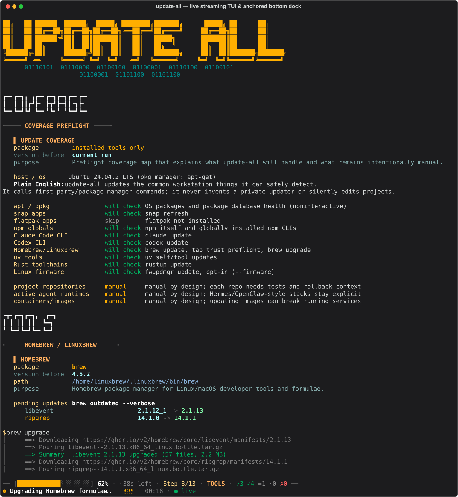
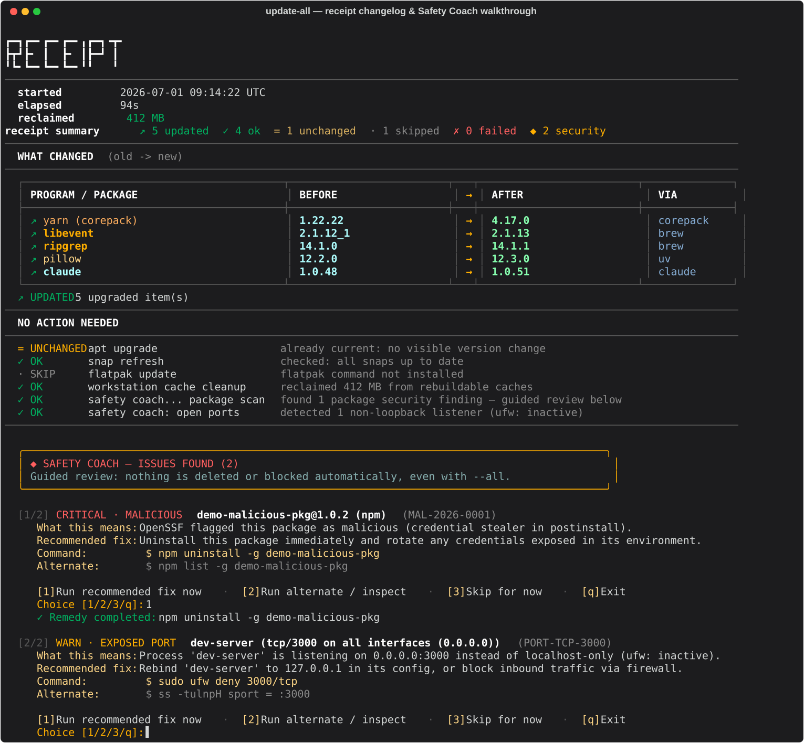

# Update All Cmd

Universal, local-first Linux workstation updater in modular Bash: one command for distro and developer-tool updates, zero mid-run stalls, an anchored live TUI progress dock, bounded disk cleanup, dramatic changelog receipts, and built-in **Safety Coach** security checks.

[](https://github.com/psychofanPLAYS/Update-All-Cmd/actions/workflows/ci.yml)




`update-all` automatically discovers your Linux distribution, system package manager, and installed developer tooling, then updates them in one calm, transparent pass — with live unbuffered streaming, an anchored bottom progress bar with self-calibrating ETAs, reclaimed disk-space reporting, a readable `BEFORE → AFTER` changelog receipt, and an end-of-run **Safety Coach** walkthrough.

It is built for Linux developer workstations (Ubuntu/Debian, Fedora/RHEL/Silverblue, Arch, openSUSE, Alpine, Void). It is **not** a fleet patching system or production server automation.

```bash
./install.sh
update-all --dry-run
update-all
```

## Receipt & Safety Coach Preview



## What You Get

- **Universal Linux auto-discovery:** Reads `/etc/os-release` and detects installed system and developer package managers automatically — missing tools report `SKIP` and never fail the run.
- **Zero-stall, zero-mid-run-Enter execution:** Streams command output live with `stdbuf -oL -eL` and closed stdin (`</dev/null`), runs apt with `DEBIAN_FRONTEND=noninteractive`, `NEEDRESTART_MODE=l`, `UCF_FORCE_CONFFOLD=1`, and `DPkg::Lock::Timeout=60`, maintains a background `sudo` keepalive, and enforces bounded timeouts (`timeout -k`) on every probe, updater, and build step.
- **Anchored 2-row TUI dock & kinetic watcher:** Pins a live progress bar at the bottom (`--bar=bottom`, or `--bar=top` / `--bar=off`) with self-calibrating EWMA ETAs persisted to `${XDG_CACHE_HOME:-~/.cache}/update-all/timings.tsv`, `SIGWINCH` dynamic terminal resize handling, compact min-size adaptation, live status counters (`↗ ✓ = · ✗`), and a monochrome pulsing watcher (`--watcher=hybrid` combining star + braille wave, `--watcher=braille`, or `--watcher=anthropic`).
- **Refined visual hierarchy:** Signature amber `UPDATE ALL` banner with dark-teal binary divider, monochrome Unicode glyphs (`↗ ✓ = ✗ · ▲ ◆ → │ ▌`) with automatic ASCII fallback (`UPDATE_ALL_ASCII=1`), vertical `│` log gutter for dimmed live output, and prominent tool cards with `version before` and `version after`.
- **Upfront choices, unattended sweep:** Optional cleanup and tap-trust decisions are collected before updates start (or auto-approved with `-a` / `--all`), while firmware flashing stays strictly opt-in via `--firmware`.
- **Safe, bounded cleanup with reclaimed disk stats:** Distro-aware system package cleanup (`apt`, `dnf`, `pacman`, `apk`) plus explicit bounded workstation cache cleanup (no slow full-`$HOME` crawls!) that measures and reports exact reclaimed disk space (for example, `412 MB`) in the final receipt.
- **Dramatic `RECEIPT` changelog table:** Summarizes every upgraded tool in a Unicode `WHAT CHANGED` table (`PROGRAM / PACKAGE | BEFORE → AFTER | VIA`) with bright cyan before versions, bold amber `→`, and bright mint after versions, followed by `NEEDS YOUR ATTENTION`, compact `NO ACTION NEEDED`, `RUN DETAILS`, `CLEANUP NEXT STEPS`, and `AFTER-RUN CHECK-IN`.
- **Built-in Safety Coach Mode:** Checks Homebrew tap trust, audits global packages against OpenSSF/OSV (`MAL-*` malicious packages + Critical/High CVEs/GHSAs), inspects non-loopback open listening ports and firewall posture (`ufw` / `firewalld`), and walks you through plain-English guided remedies at the end — never auto-deleting packages or editing firewall rules, even under `--all`.
- **Modular source + single-file portable build:** Clean `lib/*.sh` modules with `scripts/build-standalone.sh` generating a self-contained `dist/update-all` bundle.
- **Public-safe & secret-redacting:** Redacts common API key, token, private-key, and `PASSWORD=` shapes from streamed logs and runs internal subshells with `BASH_ENV`/`ENV` unset (`bash --noprofile --norc`).

## Who This Is For

- Developers running Linux workstations with a mix of OS packages, Homebrew/Linuxbrew, Node/Bun/Deno, Python (`uv`/`pipx`), Rust, GitHub CLI, and coding-agent CLIs (`claude`, `codex`) who want one reliable update sweep.
- Learners who copied install commands from docs or tutorials and want plain-English explanations before scary package-manager output starts.
- Anyone tired of updates hanging halfway through on a `needrestart` dialog, dpkg lock, or expired `sudo` timestamp.

## Install

Run directly from the repository:

```bash
./bin/update-all --dry-run
```

Install into your user-local `PATH`:

```bash
./install.sh
update-all --dry-run
```

Or build a single portable standalone script (`dist/update-all`) from the modular `lib/*.sh` tree:

```bash
./scripts/build-standalone.sh
./dist/update-all --dry-run
```

If `~/.local/bin` is not on your `PATH`, add it to your shell profile:

```bash
export PATH="$HOME/.local/bin:$PATH"
```

## Usage

```bash
update-all [options]
```

| Option | What it does |
| --- | --- |
| `--dry-run` | Prints each update command without applying updates. |
| `-a`, `--all` | Auto-approves all safe updates and cache cleanup (zero upfront prompts). Firmware remains opt-in (`--firmware`); Safety Coach still runs its guided walkthrough at the end. |
| `--firmware` | Opts in to applying installable Linux firmware updates (`fwupdmgr`). |
| `--no-anim` | Disables live watcher animations and the pinned TUI dock. |
| `--no-color` | Disables ANSI color output (also honors `NO_COLOR`). |
| `--no-security-scan` | Skips OSV malicious/advisory package checks and open-port Safety Coach scans. |
| `--non-interactive` | Never prompts for keyboard input; prints actionable Safety Coach remedies instead. |
| `--watcher=MODE` | Sets live watcher style: `hybrid` (default), `braille`, or `anthropic`. |
| `--bar=POS` | Sets persistent TUI progress dock position: `bottom` (default), `top`, or `off`. |
| `-h`, `--help` | Shows command help. |

Common flows:

```bash
# Preview the update plan first
update-all --dry-run

# Interactive workstation update sweep with live bottom dock and Safety Coach
update-all

# Unattended safe sweep (auto-approves safe updates & cache cleanup; keeps firmware opt-in)
update-all --all

# Include Linux firmware updates explicitly
update-all --all --firmware

# Alternate dock/watcher styles
update-all --bar=top --watcher=braille
update-all --bar=off --watcher=anthropic

# Quiet log-friendly / CI smoke-test mode
update-all --dry-run --no-anim --no-color
```

## Supported Update Surfaces

Missing tools are reported as `SKIP`, never treated as fatal.

### Linux System & Desktop Package Managers

| Tool | Area |
| --- | --- |
| `dpkg` / `apt` | Debian/Ubuntu package health, noninteractive index update, upgrades, opt-in cleanup |
| `rpm-ostree` | Atomic Fedora/Silverblue/Kinoite immutable OS image upgrades |
| `dnf5` / `dnf` / `yum` | Fedora/RHEL/CentOS/Rocky OS package upgrades and opt-in cleanup |
| `pacman` | Arch Linux official repo upgrades (non-AUR) and opt-in cache cleanup |
| `zypper` | openSUSE repository refresh and OS upgrades |
| `apk` | Alpine Linux index update, upgrades, and opt-in cache cleanup |
| `xbps` (`xbps-install`) | Void Linux repository sync and OS upgrades |
| `snap` | Snap application refreshes |
| `flatpak` | Sandboxed desktop Flatpak app updates |
| `fwupdmgr` | Linux vendor firmware checks and `FIRMWARE REVIEW` cards (strictly opt-in via `--firmware` or interactive prompt) |

### Developer Runtimes, CLIs & Tools

| Tool | Area |
| --- | --- |
| Homebrew / Linuxbrew | `brew update`, cached tap-trust preflight, `brew upgrade` |
| `node` / `update-node` | Local Node.js runtime upkeep |
| `mise`, `volta`, `fnm` | Polyglot & Node.js runtime/version managers |
| `corepack`, `pnpm`, `yarn` | Node package-manager shims and activated managers |
| `bun`, `deno` | First-party `bun upgrade` and `deno upgrade` |
| `npm` globals | `npm` self-update and globally installed npm CLIs |
| Claude Code (`claude`) | First-party `claude update` |
| Codex (`codex`) | First-party `codex update` |
| `uv`, `pipx` | Python tool environments and isolated CLI apps |
| `rustup`, `cargo` | Rust toolchains (`rustup update`) and Cargo CLIs (`cargo install-update -a` when installed) |
| `gh` extensions | GitHub CLI extensions (`gh extension upgrade --all`) |
| `code`, `codium`, `code-insiders` | Editor extension updates (leaves settings and projects untouched) |

### Pending Update Lists (`old -> new`)

| Tool | Pending list source |
| --- | --- |
| `apt` | `apt list --upgradable`, parsed as `package old -> new` |
| `npm globals` | `npm outdated -g`, parsed as `package current -> latest` |
| Homebrew / Linuxbrew | `brew outdated --verbose`, parsed where output includes old/new versions |

### Manual by Design

The `COVERAGE PREFLIGHT` explicitly names areas `update-all` will never touch automatically: project repositories, active agent runtimes (such as Hermes/OpenClaw stacks), containers/images, conda environments, AUR PKGBUILDs, large LLM weights, and shell profile edits.

## Safety Coach Mode

Safety Coach runs automatically at the end of `update-all` (disable with `--no-security-scan` or `UPDATE_ALL_SECURITY_SCAN=0`). It never auto-deletes packages or auto-modifies firewall rules — even when you run `update-all --all`.

1. **OSV.dev Malicious & Advisory Scan (`api.osv.dev/v1/querybatch`):** Audits globally installed `npm`, `uv`, `pipx`, `cargo`, and `brew` packages by sending **only** `(package name, ecosystem, version)` — never credentials, hostnames, or file paths. Flags OpenSSF `MAL-*` malicious packages as `CRITICAL` and Critical/High CVE/GHSA advisories as `HIGH`. If you are offline or the API is unreachable, it skips cleanly without failing the run.
2. **Open-Port & Firewall Posture Check:** Runs a read-only local socket check (`ss -tulnpH` / `netstat`) and checks `ufw`/`firewalld` status, flagging non-loopback listeners bound to `0.0.0.0`, `::`, or LAN interfaces in plain English.
3. **Homebrew Tap Trust Preflight:** Inspects third-party taps via cached `brew tap-info` and renders a plain-English `INSIGHT` panel whenever Homebrew reports an `Untrusted` tap.
4. **Guided Post-Receipt Walkthrough:** When findings exist, prints the `◆ SAFETY COACH — ISSUES FOUND` panel after the receipt and lets you choose per finding: `[1]` run recommended fix, `[2]` run alternate / inspect command, `[3]` skip for now, or `[q]` exit. Under `--non-interactive` or `--dry-run`, it prints the exact commands without executing them.

## Cleanup Behavior

Cleanup stays opt-in and split into two explicit choices (both auto-approved only when you pass `-a`/`--all` or answer `y`/`all` upfront):

1. **System package cleanup:** Runs only the detected distro package manager's native cleanup (`apt-get autoremove --purge -y` + `autoclean` + `clean`, `dnf autoremove -y` + `clean packages`, `pacman -Sc --noconfirm`, or `apk cache clean`).
2. **Bounded workstation cache cleanup:** Targets explicit rebuildable caches only (`npm` / `~/.npm/_npx`, `pip3`, `brew cleanup -s`, bounded `uv cache prune`, known `~/.cache/{camoufox,ms-playwright,BraveSoftware,electron,node-gyp,node,Homebrew,pip}` directories, `~/.codex/.tmp/plugins*`, disabled snap revisions, and `journalctl --vacuum-size=512M`). It **never** crawls all of `$HOME` and never deletes archives, LLM weights, databases, project data, or active virtualenvs. Before/after disk usage is measured and reported as reclaimed space in the final receipt.

## Configuration

| Environment Variable | Default | Purpose |
| --- | --- | --- |
| `UPDATE_ALL_BAR` | `bottom` | Persistent TUI dock position: `bottom`, `top`, or `off`. |
| `UPDATE_ALL_WATCHER` | `hybrid` | Kinetic watcher style: `hybrid`, `braille`, or `anthropic`. |
| `UPDATE_ALL_ANIM` | `1` | Set to `0` to disable animations and pinned TUI dock. |
| `UPDATE_ALL_COLOR` | `1` | Set to `0` (or set `NO_COLOR`) to disable ANSI colors. |
| `UPDATE_ALL_ASCII` | `0` | Set to `1` to force pure ASCII glyphs instead of Unicode. |
| `UPDATE_ALL_SECURITY_SCAN` | `1` | Set to `0` to skip OSV and open-port Safety Coach scans. |
| `UPDATE_ALL_NONINTERACTIVE` | `0` | Set to `1` to disable all keyboard prompts. |
| `UPDATE_ALL_PROBE_TIMEOUT` | `15s` | Timeout for version and preflight probes. |
| `UPDATE_ALL_COREPACK_TIMEOUT` | `90s` | Timeout for `corepack` steps. |
| `UPDATE_ALL_NODE_TIMEOUT` | `300s` | Timeout for `update-node`. |
| `UPDATE_ALL_STEP_TIMEOUT` | `600s` | Default timeout for package-manager update commands. |
| `UPDATE_ALL_BUILD_TIMEOUT` | `1200s` | Timeout for source-compiling steps (such as `cargo`). |
| `UPDATE_ALL_TIMINGS_FILE` | `~/.cache/update-all/timings.tsv` | Self-calibrating EWMA step-duration store for ETA estimates. |
| `UPDATE_ALL_SUDO_SECRET_KEY` | *(unset)* | Optional external `secret` helper key name for `sudo -S`. |

### Optional Sudo Secret Helper

`update-all` never stores sudo passwords in the repository. If your workstation already has a compatible external `secret` helper, export its key name:

```bash
export UPDATE_ALL_SUDO_SECRET_KEY="your-key-name"
```

When configured, the secret value is piped over stdin to `sudo -S` without printing it; otherwise, `update-all` primes `sudo -v` once upfront and runs a lightweight background keepalive so multi-minute updates never stall waiting for a password.

## Safety And Privacy

- **Local-first and transparent:** No telemetry, no analytics, no account required. Package managers make their normal registry requests, and the optional OSV Safety Coach query sends only `(package, ecosystem, version)` tuples to `api.osv.dev` (disable anytime with `--no-security-scan`).
- **Defensive log redaction:** Streamed command output redacts OpenAI keys, GitHub tokens, Slack tokens, AWS access keys, private-key headers, and `TOKEN=`/`PASSWORD=` style lines before printing.
- **Clean subshell boundary:** Internal compound shell commands unset `BASH_ENV` and `ENV` and invoke `bash --noprofile --norc`, never sourcing `.bashrc` or shell startup files for control flow.
- **Safe defaults:** Firmware flashing is opt-in (`--firmware`), Safety Coach remedies require explicit confirmation, and active agent runtimes like Hermes/OpenClaw are skipped intentionally.

## Verification

Run the local quality gate before committing:

```bash
bash -n bin/update-all lib/*.sh install.sh scripts/build-standalone.sh
shellcheck bin/update-all lib/*.sh install.sh scripts/build-standalone.sh tests/test-output-format.sh
bash tests/test-output-format.sh
./scripts/build-standalone.sh
./bin/update-all --help
./bin/update-all --dry-run --no-anim --no-color
cspell README.md bin/update-all install.sh docs/UPDATE_ALL_HANDOFF.md cspell.json tests/test-output-format.sh CONTRIBUTING.md SECURITY.md CODE_OF_CONDUCT.md .github/*.md .github/*.yml .github/**/*.md .github/**/*.yml
git diff --check
```

## Project Layout

```text
.
|-- bin/
|   `-- update-all                     # CLI entrypoint & orchestrator
|-- lib/
|   |-- colors_and_glyphs.sh           # 256/8/0-color palette, monochrome glyphs, cards
|   |-- tui.sh                         # DECSTBM bottom/top dock, watcher, EWMA ETA store
|   |-- runner.sh                      # Zero-stall FIFO runner, redactor, sudo keepalive
|   |-- discover.sh                    # Universal Linux distro/tool discovery & preflight
|   |-- updaters.sh                    # Distro & dev-tool updaters + delta capture
|   |-- cleanup.sh                     # Distro pkg cleanup + bounded cache cleanup
|   |-- safety_coach.sh                # Tap trust, OSV audit, open ports, guided remedy
|   `-- receipt.sh                     # Upgraded RECEIPT & WHAT CHANGED changelog table
|-- scripts/
|   `-- build-standalone.sh            # Bundles bin/ + lib/ -> dist/update-all
|-- dist/
|   `-- update-all                     # Generated standalone single-file build
|-- docs/
|   |-- terminal-preview.svg           # Live streaming TUI & bottom dock preview
|   |-- receipt-and-safety-preview.svg # Receipt changelog & Safety Coach preview
|   `-- UPDATE_ALL_HANDOFF.md          # Engineering & UX contract notes
|-- tests/
|   `-- test-output-format.sh          # Automated format, stall, watcher & safety tests
|-- install.sh                         # Symlinks bin/update-all -> ~/.local/bin/update-all
|-- cspell.json
|-- LICENSE
`-- README.md
```

Primary entrypoint: [bin/update-all](bin/update-all)

## License

MIT. See [LICENSE](LICENSE).
